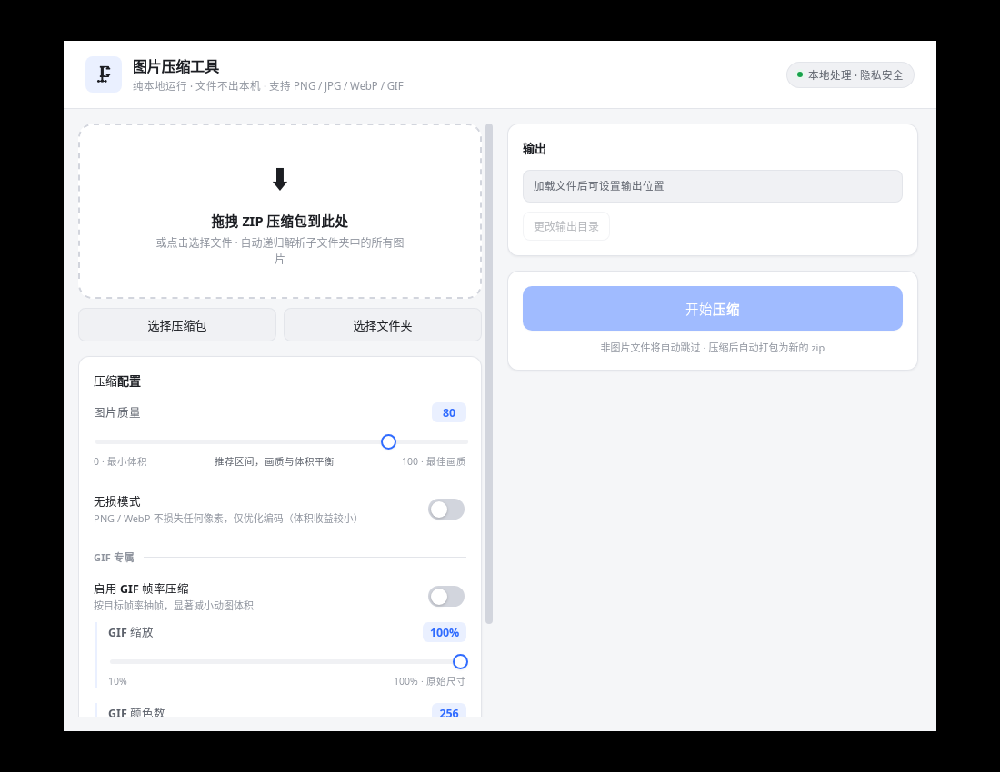

# 图片压缩工具 (Image Compressor)



一款完全**本地运行**的 macOS 桌面图片批量压缩工具，基于 **Tauri 2 + Rust + React**。
支持解析 ZIP 压缩包 / 文件夹，递归读取所有子目录图片，批量压缩后自动打包成新的 ZIP。

> **隐私优先**：所有解压、压缩、打包全部在本机内存与磁盘完成，**不发起任何网络请求**，图片不会离开你的电脑。

---

## ✨ 功能特性

| 能力 | 说明 |
| --- | --- |
| **格式支持** | PNG、JPG/JPEG、WebP、GIF（另兼容 BMP / TIFF 输入） |
| **输入方式** | 拖拽 ZIP 压缩包到窗口 / 点击选择文件 / 选择整个文件夹 |
| **递归解析** | 自动读取压缩包内所有层级子文件夹中的图片，忽略 `__MACOSX` 等元数据 |
| **质量滑块** | 0-100 可调，实时提示画质与体积的权衡区间 |
| **无损模式** | PNG / WebP 可选无损编码，不损失任何像素 |
| **GIF 专属** | 帧率抽帧（1-30 fps）+ 尺寸缩放（10-100%）+ 调色板颜色数（2-256） |
| **目录结构保持** | 压缩后输出 ZIP 内保持原有文件夹层级 |
| **自动打包** | 全部处理完成后自动生成 `原名-compressed.zip` |
| **一键保存** | 「在访达中显示」直接定位到输出文件 |
| **进度反馈** | 实时进度条 + 当前处理文件名 |
| **体积对比** | 压缩前后总大小对比 + 节省百分比 + 逐文件明细 |
| **错误处理** | 非图片文件自动跳过并计数，单文件失败不影响整体 |

---

## 🏗 技术架构

```
image-compressor/
├── src/                          # React + TypeScript 前端
│   ├── App.tsx                   # 主状态机（idle → ready → compressing → done）
│   ├── api.ts                    # Tauri 命令封装
│   ├── types.ts                  # 共享类型定义
│   ├── styles.css                # 界面样式（含深色模式）
│   └── components/
│       ├── DropZone.tsx          # 拖拽上传区
│       ├── SettingsPanel.tsx     # 压缩配置面板
│       ├── ProgressPanel.tsx     # 进度条
│       ├── ResultPanel.tsx       # 压缩结果对比
│       └── Toasts.tsx            # 轻提示
│
└── src-tauri/                    # Rust 后端
    ├── src/
    │   ├── lib.rs                # Tauri 命令入口
    │   ├── compress.rs           # 压缩核心（各格式编码器）
    │   └── archive.rs            # ZIP 解析 / 递归读取 / 重新打包
    ├── Cargo.toml
    ├── tauri.conf.json
    ├── entitlements.plist        # macOS 权限声明
    ├── capabilities/default.json # Tauri 权限集
    └── icons/                    # 应用图标
```

### 压缩实现细节

| 格式 | 策略 | 关键参数 |
| --- | --- | --- |
| **JPEG** | 有损重编码 | `quality` 1-100 直接传给编码器 |
| **PNG** | 无损重编码 | `CompressionType::Best` + `FilterType::Adaptive` |
| **WebP** | 有损 / 无损（libwebp） | `encode(quality)` 或 `encode_lossless()` |
| **GIF** | 合成帧 → 抽帧 → 缩放 → 量化 → 重编码 | 帧率、缩放比例、颜色数 |

GIF 处理流程（`compress.rs::compress_gif`）：
1. 逐帧解码并**合成完整画布**（正确处理 disposal method，还原动图真实观感）
2. 按目标帧率**累积帧延迟抽帧**（如 30fps → 12fps，丢弃中间帧）
3. 按比例**缩放**（Lanczos 降采样）
4. 使用 **NeuQuant 算法量化**调色板到指定颜色数
5. 重新编码为 GIF，保留循环播放

**智能保底**：任何格式若压缩后体积反而变大（或解码失败），自动保留原文件，绝不让结果比原始更大。

---

## 📦 环境要求

### macOS（目标平台）

| 依赖 | 版本 | 安装方式 |
| --- | --- | --- |
| Xcode Command Line Tools | 最新 | `xcode-select --install` |
| Rust | ≥ 1.77.2 | `curl --proto '=https' --tlsv1.2 -sSf https://sh.rustup.rs \| sh` |
| Node.js | ≥ 18 | `brew install node` |
| pnpm | ≥ 8 | `npm i -g pnpm` |

> Tauri 会自动使用 macOS 自带的 WebKit，无需额外安装浏览器内核。

### 通用

```bash
# 安装 Tauri CLI（可选，pnpm 已包含）
cargo install tauri-cli --version "^2"
```

---

## 🚀 快速开始

```bash
# 1. 进入项目目录
cd image-compressor

# 2. 安装前端依赖
pnpm install

# 3. 开发模式（热重载，自动打开应用窗口）
pnpm tauri dev

# 4. 构建正式版 Mac 应用
pnpm tauri build
```

首次 `cargo` 编译需要下载并编译约 300 个 crate，耗时 5-15 分钟属正常现象。

---

## 🍎 打包 Mac 应用（详细步骤）

### 步骤 1：准备签名证书（可选，但推荐）

不做签名也能打包出 `.app`，但首次打开会被 Gatekeeper 拦截。若你有 Apple Developer 账号：

```bash
# 查看可用签名身份
security find-identity -v -p codesigning

# 设置环境变量（供 Tauri 自动签名）
export APPLE_SIGNING_IDENTITY="Developer ID Application: Your Name (TEAMID)"
```

若需公证（Notarization），额外设置：

```bash
export APPLE_ID="your@email.com"
export APPLE_PASSWORD="xxxx-xxxx-xxxx-xxxx"   # App 专用密码
export APPLE_TEAM_ID="YOURTEAMID"
```

### 步骤 2：构建

```bash
cd image-compressor

# 同时产出 .app 与 .dmg（tauri.conf.json 中 targets: ["app", "dmg"]）
pnpm tauri build
```

#### 按芯片架构构建

```bash
# Apple Silicon (M 系列)
rustup target add aarch64-apple-darwin
pnpm tauri build --target aarch64-apple-darwin

# Intel
rustup target add x86_64-apple-darwin
pnpm tauri build --target x86_64-apple-darwin

# 通用二进制（同时支持 Intel + Apple Silicon，体积翻倍）
rustup target add aarch64-apple-darwin x86_64-apple-darwin
pnpm tauri build --target universal-apple-darwin
```

### 步骤 3：获取产物

构建完成后，产物位于：

```
src-tauri/target/release/bundle/
├── macos/
│   └── 图片压缩工具.app          # 可直接拖入「应用程序」目录
└── dmg/
    └── 图片压缩工具_0.1.0_aarch64.dmg   # 分发给用户
```

（若指定了 `--target`，路径为 `src-tauri/target/<target>/release/bundle/`）

### 步骤 4：安装与分发

```bash
# 直接运行
open "src-tauri/target/release/bundle/macos/图片压缩工具.app"

# 复制到应用程序目录
cp -R "src-tauri/target/release/bundle/macos/图片压缩工具.app" /Applications/
```

**未签名版本的打开方式**（分发给他人时告知对方）：

```bash
# 方式一：移除隔离属性
xattr -cr /Applications/图片压缩工具.app

# 方式二：右键点击 App → 打开 → 在弹窗中再次点击「打开」
```

---

## 🐧 在 Linux 上交叉验证（可选）

本项目目标平台是 macOS，但若想在 Linux 环境验证编译（Linux 无法产出 Mac 产物）：

```bash
sudo apt-get update
sudo apt-get install -y libwebkit2gtk-4.1-dev build-essential curl wget file \
  libxdo-dev libssl-dev libayatana-appindicator3-dev librsvg2-dev

pnpm install
pnpm tauri build          # 产出 AppImage / deb
```

> **注意**：macOS 的 `.app` / `.dmg` 必须在 macOS 上构建，无法在 Linux 交叉编译。

---

## 📖 使用说明

1. **加载文件**：把 ZIP 压缩包拖到窗口中央，或点击「选择压缩包」/「选择文件夹」
2. **确认解析**：界面会显示识别到的图片数量和总大小
3. **调整参数**：
   - 拖动「图片质量」滑块（60-85 为推荐区间）
   - 需要像素级无损时打开「无损模式」
   - 处理 GIF 时按需开启「GIF 帧率压缩」并调整缩放与颜色数
4. **设置输出**：默认输出到源文件同目录，可点「更改输出目录」
5. **开始压缩**：点击「开始压缩」，实时查看进度
6. **保存结果**：完成后点击「在访达中显示」定位输出 ZIP

---

## 🔒 隐私说明

- ❌ 无任何 HTTP/网络请求代码
- ❌ 无遥测、无崩溃上报、无统计
- ✅ 解压、压缩、打包全部在本地内存与临时文件中完成
- ✅ 输入的 ZIP 与图片**从不被修改**，只读取
- ✅ macOS 权限仅申请「用户选定文件的读写」，且关闭了 App Sandbox 以支持任意目录拖拽

`tauri.conf.json` 中的 CSP 已收紧为 `default-src 'self'`，禁止加载任意外部资源。

---

## 🧪 测试与验证

项目自带 15 个单元/集成测试，覆盖压缩核心与压缩包流程：

```bash
cd image-compressor
pnpm test              # 等价于 cd src-tauri && cargo test
```

测试覆盖点：

| 测试 | 验证内容 |
| --- | --- |
| `supported_extensions` | 格式白名单识别（含大小写、无扩展名） |
| `jpeg_quality_affects_size` | 质量参数确实影响体积；输出可解码 |
| `png_is_lossless_and_valid` | **PNG 压缩后像素完全一致**（真无损） |
| `png_preserves_alpha` | PNG alpha 通道保留 |
| `webp_lossy_and_lossless` | WebP 有损/无损两种路径 |
| `gif_frame_dropping_works` | **20 帧 → 抽帧后帧数下降** |
| `gif_scaling_works` | GIF 50% 缩放后尺寸正确 |
| `gif_no_frame_drop_keeps_all_frames` | 不启用帧率压缩时帧数不变 |
| `compress_or_original_never_grows` | **压缩后绝不比原图大** |
| `corrupt_data_falls_back_to_original` | 损坏数据原样保留不崩溃 |
| `quality_zero_is_clamped_not_panicking` | 边界值（quality=0）不 panic |
| `quality_and_color_limits_are_clamped` | 越界参数被 clamp |
| `mismatched_extension_is_rejected` | 扩展名与内容不符时安全兜底 |
| `zip_preserves_structure_and_skips_non_images` | **嵌套目录保留 + 非图片跳过 + __MACOSX 过滤 + 输出可解码** |
| `zip_with_no_images_errors` | 无图片时返回明确错误 |

### 手动验证（真实图片）

```bash
# 1. 生成测试素材（需要 Python + Pillow）
pnpm test:data                       # 产出 /tmp/ic-testdata/input.zip

# 2. 用命令行工具跑一次压缩
cd src-tauri
cargo run --bin compress_test -- /tmp/ic-testdata/input.zip /tmp/out.zip
```

实测输出示例（20 帧 GIF + 高熵 PNG/JPG/WebP）：

```
总图片数:     7
成功压缩:     7
跳过非图片:   3
原图总大小:   500540 bytes
压缩后总大小: 350629 bytes
节省:         29.9%

sub/deep/photo3.png   92091 -> 85180  ↓8%     # PNG 无损调优
sub/photo2.jpg        72889 -> 25788  ↓65%    # JPEG 有损
anim.webp             62034 -> 37114  ↓40%    # WebP 有损
anim.gif              16455 ->  6399  ↓61%    # 20帧→10帧 抽帧
```

---

## ⚙️ 可调参数速查

| 场景 | 建议配置 |
| --- | --- |
| 网页图片（追求体积） | 质量 65-75，无损关闭 |
| 相册备份（追求画质） | 质量 88-95，无损关闭 |
| 图标 / 线稿 PNG | 无损模式开启 |
| 表情包 GIF | 帧率 8-12 fps，缩放 60-80%，颜色数 128 |
| 高清动图 GIF | 帧率 15-20 fps，缩放 100%，颜色数 256 |

---

## 🧰 常见问题

**Q: 打包出的 App 提示「已损坏，无法打开」？**
A: 这是 Gatekeeper 对未签名应用的默认拦截。执行 `xattr -cr <App路径>`，或右键 → 打开。

**Q: `pnpm tauri build` 报错找不到 `webkit2gtk`？**
A: 这是 Linux 专属依赖。macOS 上不会出现该问题，macOS 使用系统自带 WebKit。

**Q: 编译很慢 / 内存占用高？**
A: 首次编译需构建整个依赖树。可在 `src-tauri/Cargo.toml` 的 `[profile.release]` 中把 `lto = true` 改为 `lto = false` 加速，代价是产物体积略增。

**Q: GIF 压缩后画质变差？**
A: GIF 最多 256 色，本身是有损格式。建议把「颜色数」调到 256、缩放保持 100%，仅在必要时降低帧率。

**Q: 支持多大体积的压缩包？**
A: 受可用内存限制。当前实现会将被解压的图片读入内存后并行压缩，建议单个 ZIP 不超过 2 GB。

---

## 📄 许可证

MIT
